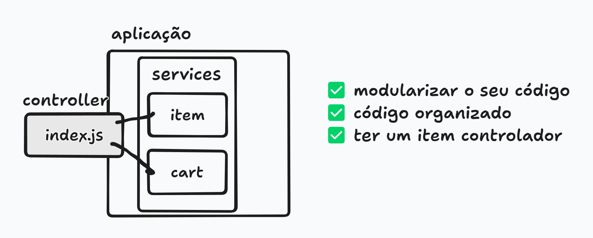
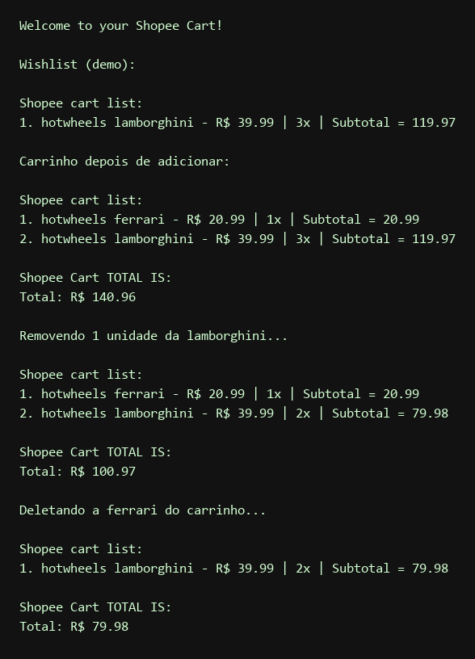

# Carrinho da Shopee — Node.js (ESM)

Lab da DIO (Formação Node.js Fundamentals). Recria a lógica do carrinho: item com subtotal, carrinho que adiciona / remove unidade / deleta, wishlist e total no terminal.

Foco do desafio: **modularização** com ES Modules (`"type": "module"`).

## Como rodar

```bash
npm start
# ou
node src/index.js
```

Node 18+.

## O que o código faz

| Módulo | Responsabilidade |
| --- | --- |
| `src/services/item.js` | Cria item (`name`, `price`, `quantity`) com `subtotal()` |
| `src/services/cart.js` | `addItem`, `removeItem`, `deleteItem`, `displayCart`, `calculateTotal` |
| `src/index.js` | Demo: carrinho + wishlist, remove 1 unidade, deleta item, mostra total |

Melhoria em relação ao base: o `subtotal()` usa `this.price * this.quantity`, então quando a quantidade muda no `removeItem`, o valor acompanha.

## Ordem do passo a passo

1. `npm init` + `"type": "module"`  
2. Domínio: carrinho e itens  
3. Arquivos em `src/services/`  
4. Assinaturas e lógica do `item.js`  
5. `addItem` + `calculateTotal`  
6. Wishlist (array separado)  
7. `displayCart`  
8. `removeItem` (diminui unidade) e `deleteItem` (tira pelo nome)  

## Arquitetura



## Print da demo



## Links

- Repo: https://github.com/sir-devtech/Carrinho_da_Shopee_NodeJS  
- Projeto base (DIO): https://github.com/digitalinnovationone/formacao-nodejs/tree/main/06-shopee-cart  
